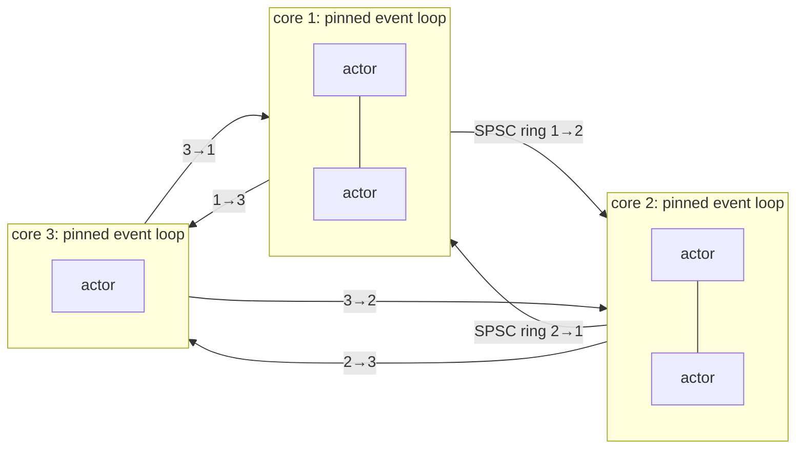

# cannes

**A thread-per-core actor engine for Rust, built for low latency.** One pinned, busy-polling
event loop per CPU core; actors that never leave their core; lock-free SPSC rings between cores.
About **600 ns per inter-core round trip**, within 10 to 20 ns of the hardware floor, and about
**2× faster than the C++ framework it is modelled on** ([Tredzone simplx](https://github.com/Tredzone/simplx)).

[](https://github.com/jc19000/cannes/actions/workflows/ci.yml)
[](https://crates.io/crates/cannes)
[](https://docs.rs/cannes)
[](LICENSE)

Use it for trading systems, matching engines, market-data handlers, packet processing, game
servers: anything where you would rather dedicate cores than share them, and where a
microsecond matters. No async runtime, no work stealing, no locks on the hot path, no
dependencies.

## Why thread-per-core

General-purpose actor frameworks (actix, ractor, kameo…) run on async runtimes such as tokio:
actors migrate between threads, mailboxes are multi-producer queues, and every message wakes a
task. That is flexible, and it costs microseconds.

`cannes` takes the opposite trade-off, the one of Seastar, LMAX-style designs and simplx:

- **Each core owns its actors.** Actor state is plain Rust: no `Mutex`, no `Arc`, no atomics, no
  `Send` bound. The cache stays hot because nothing else touches it.
- **Cores never contend.** Each ordered pair of cores has its own single-producer /
  single-consumer ring, so no queue ever has two writers and no compare-and-swap is needed.
- **Batched publication.** Events sent during a loop iteration are published with one Release
  store per destination core at the end of the iteration, or immediately with `ctx.flush()`.
- **Zero-copy delivery.** Handlers get a reference into the ring itself.
- **Predictable.** The loop busy-polls on a pinned core: no syscalls, no OS scheduler, no
  wake-ups on the event path.



Each loop iteration: drain the inbound rings and dispatch each event to its handler, dispatch
same-core events, run callbacks and destroy requests, then publish everything sent to other cores.

## Example

```rust
use cannes::{Actor, ActorId, Context, Engine, Handler, StartSequence};

struct Ping(u64);

struct Pong;
impl Actor for Pong {
    fn on_start(&mut self, ctx: &mut Context) {
        ctx.register_handler::<Ping, Self>();
    }
}
impl Handler<Ping> for Pong {
    fn on_event(&mut self, ctx: &mut Context, src: ActorId, ping: &Ping) {
        ctx.send(src, Ping(ping.0 + 1)); // back to the sender, on its own core
    }
}

struct Starter { pong: ActorId }
impl Actor for Starter {
    fn on_start(&mut self, ctx: &mut Context) {
        ctx.register_handler::<Ping, Self>();
        ctx.send(self.pong, Ping(0));
    }
}
impl Handler<Ping> for Starter {
    fn on_event(&mut self, ctx: &mut Context, src: ActorId, ping: &Ping) {
        if ping.0 < 1_000_000 {
            ctx.send(src, Ping(ping.0 + 1));
        }
    }
}

fn main() {
    let mut sequence = StartSequence::new();
    let pong = sequence.add_actor(2, || Pong);              // loop pinned to core 2
    sequence.add_actor(1, move || Starter { pong });        // loop pinned to core 1
    let engine = Engine::start(sequence);
    std::thread::sleep(std::time::Duration::from_secs(1));
    for c in engine.shutdown() {                            // final per-core counters
        println!("core {}: {} events, {}/{} busy loops", c.core, c.events, c.loop_usage, c.loop_total);
    }
}
```

```toml
[dependencies]
cannes = "0.1"
```

## Features

| | |
|---|---|
| **Events** | Any `Send + 'static` type, any size; per-type handlers; in-order delivery between two actors |
| **Undelivered events** | Come back to the sender (no such actor, no handler, or `ctx.return_to_sender()`) |
| **Lifecycle** | Start actors per core, dynamic creation, a destroy protocol an actor can postpone, end-of-iteration callbacks |
| **Services** | Actors reachable by tag from any core |
| **Direct calls** | `ActorRef<A>`: synchronous method calls between actors of the same core, destruction blocked while referenced, circular references refused, per-core singletons |
| **Timers** | One timer service, one hub per core, one cross-core event per tick whatever the number of timers |
| **Flush** | End-of-iteration publication, plus `ctx.flush()` to publish immediately |
| **Counters** | Per core: loop iterations, busy iterations (saturation), events, callbacks, ring publications (batching factor), bytes per destination core |
| **Shutdown** | Regular actors first, then services; every in-flight event is dropped exactly once |

### What the compiler checks for you

These are conventions in a C++ framework; here they are compile-time or checked guarantees:

- An `ActorRef` is not `Send`: a direct reference cannot escape to another core.
- Ring endpoints are a non-clonable producer and consumer: exactly one writer and one reader.
- Cross-core events are `Send + 'static`: they cannot point into another core's memory.
- A re-entrant call into a running actor panics instead of silently aliasing it.

## Performance

Inter-core round trip, one event in flight (ping-pong between two cores), 1 M measured round trips
after 100 k warm-up, `rdtsc` timing, median of 5 interleaved runs:

| | p50 | p90 | p99 | round trips/s |
|---|---:|---:|---:|---:|
| simplx (C++), busy-spin loop | 1342 ns | 1477 ns | 3977 ns | 549 k |
| simplx (C++), default loop | 1477 ns | 1698 ns | 4638 ns | 497 k |
| **cannes** | **612 ns** | **782 ns** | **998 ns** | **1209 k** |
| two bare threads on the same rings (floor) | 597 ns | 771 ns | 926 ns | 1249 k |

KVM cloud VM, 4 vCPU Intel Xeon (Sapphire Rapids, 2.1 GHz), not tuned: no `isolcpus`, unknown vCPU
placement. Only trust p50/p90 here, and rerun on your own hardware:

```sh
bench/run.sh            # cannes vs. bare threads
bench/compare_simplx.sh # also builds simplx and runs the same benchmark in C++
```

Why simplx is slower, how a false-sharing bug once cost 300 ns per round trip, and what one
extra write per loop iteration costs: [docs/DESIGN.md](docs/DESIGN.md).

## Status and limits

- Young (0.1): API may change. 22 tests, including cross-core stress, overflow ordering, and
  drop accounting at shutdown.
- Linux for thread pinning (elsewhere, loops run unpinned). Busy-polling: each engine core runs
  at 100 % by design.
- Bounded rings (64 KiB by default) with local overflow when full; an event can be at most half a
  ring.
- A panic in a handler aborts the process; there is no per-handler error isolation.
- In-process only: no inter-process transport yet.

## Coming from simplx

`cannes` follows simplx's model closely: start sequence, `registerEventHandler`, `Event::Pipe`,
undelivered events, `requestDestroy`/`onDestroyRequest`, services, `ActorReference`, singletons,
`TimerProxy`, core performance counters. See [docs/SIMPLX.md](docs/SIMPLX.md) for the
one-to-one mapping. It is an independent implementation in Rust; no simplx code is used.

## License

Apache-2.0.
